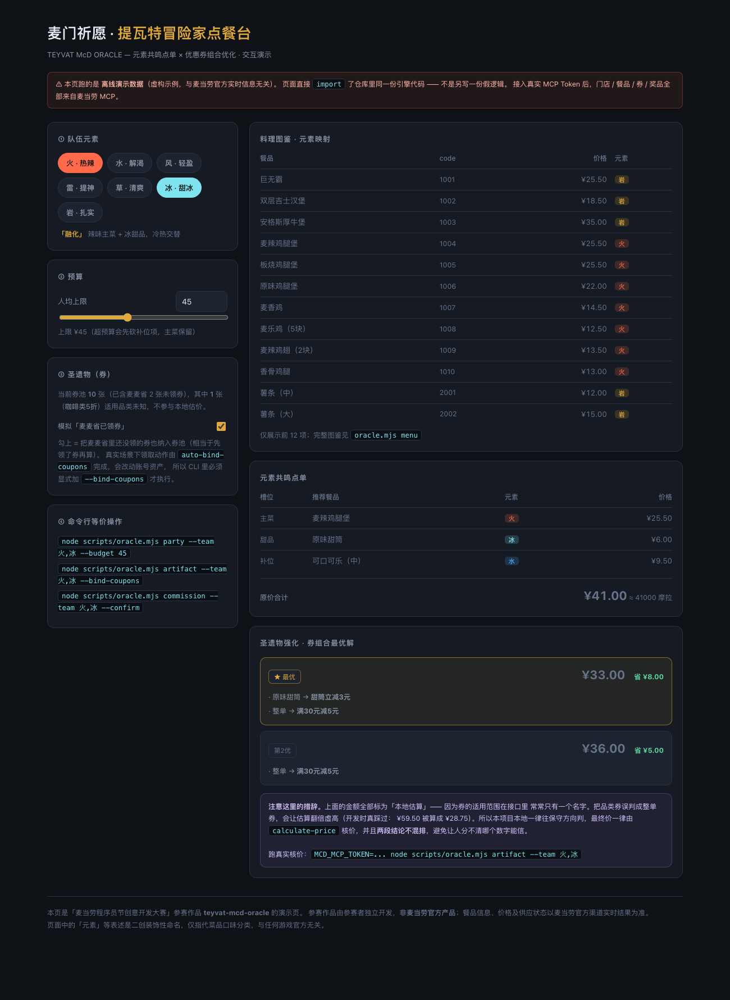

<div align="center">

# 麦门祈愿 · 提瓦特冒险家点餐台

**TEYVAT McD ORACLE**

把「在麦当劳点单」变成一次提瓦特冒险委托 —— 用队伍元素共鸣配餐，
用优惠券组合优化压低账单。

[](https://nodejs.org)
[]()
[]()
[]()
[](./LICENSE)

</div>

---

## 这是什么

麦当劳程序员创意开发大赛参赛作品。基于**麦当劳 MCP** 开发，把点餐流程重构成提瓦特冒险：

| 提瓦特 | 麦当劳真实能力 | MCP Tool |
|---|---|---|
| 传送锚点 | 附近门店 | `query-nearby-stores` |
| 料理图鉴 | 门店在售餐品 | `query-meals` |
| 元素共鸣 | 用队伍元素推导套餐搭配 | *(本地引擎)* |
| 圣遗物强化 | 优惠券组合最优解 | `query-store-coupons` / `calculate-price` |
| 祈愿台 | 积分抽奖 | `query-lottery-info` / `draw-lottery` |
| 冒险家委托 | 下单取餐 | `create-order` / `query-order` |

## 为什么值得一看

外层的梗是壳，**里面三件事是真的**：

**1. 券组合优化是正经的搜索，不是"看着差不多"**
本地 DFS 剪枝搜索产出候选方案，再由官方 `calculate-price` 逐个核价定案。
优化器有 **300 组随机用例 vs 暴力枚举**的交叉验证 —— 没有这项测试，
"剪枝"和"少搜了"看起来是一回事。

**2. 券的适用范围不透明时，不猜，去问**
券的元数据经常只有一个名字（比如「咖啡类5折」）。本项目**拿
`calculate-price` 当探针**，把券逐行挂上去问官方到底能不能打折 ——
把接口的不透明性当成一个可以被实验解决的问题。

> 开发过程中真踩过这个坑：把「咖啡类5折」误判成整单券，
> ¥59.50 被算成 ¥28.75，看着省了 ¥31.75 实际下不了单。
> 修法是把所有不确定判断一律往保守方向倒，并加了回归测试锁住。

**3. 每个金额都可验证**
要么来自官方 `calculate-price`，要么明确标注「上限 · 未核价」。
**两段结论绝不混排** —— 混排的后果是用户分不清哪个数字能信，那还不如不给数字。

## 效果预览

**[▶ 打开交互演示页](./demo/index.html)** —— 页面直接 `import` 了仓库里同一份引擎代码
（`elemental.mjs` / `artifact.mjs` 都是纯逻辑、无 Node API），不是另写一份假数据。
也可以本地跑：`python3 -m http.server 8000` 然后访问 `/demo/`。



**本地估算 vs 官方核价的措辞差异：**

```
✘ 不要这样设计：
  ★ 最优  ¥28.75   省 ¥31.75      ← 本地瞎猜，下不了单

✔ 本项目：
  原始账单 ¥59.50  （≈ 59500 摩拉）
  参战圣遗物 8 件：
    ◇ 满50元减12元                    满50元 · 减12.0元
    ◇ 咖啡类5折                       5.0折 · 适用品类未知 → 需官方核价探测
    ◇ 甜筒立减3元                     减3.0元 · 限1个商品
    ... 

  候选方案（本地估算 · 优惠上限，未向官方核价）
  ★ 最优  ¥44.50   省 ¥15.00   ≈ 15000 摩拉
        ◇ 原味甜筒                用券：甜筒立减3元
        ◇ 整单                    用券：满50元减12元

  ✦ 麦麦省还有 2 张券没领：新客满50元减8元、任意甜品立减3元
    领券会改动你的账号资产，所以默认不自动领。确认要领就加 --bind-coupons。
```

## 快速开始

**零依赖。** 不需要 `npm install`，Node 18+ 直接跑。

```bash
git clone https://github.com/<你的用户名>/teyvat-mcd-oracle.git
cd teyvat-mcd-oracle

# ① 离线看效果（不需要 Token，全链路虚构数据）
node scripts/oracle.mjs demo

# ② 跑自测（34 项断言）
node scripts/selftest.mjs
```

**接入真实麦当劳 MCP：**

```bash
export MCD_MCP_TOKEN="你的麦当劳 MCP Token"
node scripts/oracle.mjs doctor      # 自检：握手、可用工具数
node scripts/oracle.mjs anchor      # 找门店
```

Token 申请：见[麦当劳 MCP Server 使用指南](https://github.com/M-China/mcd-mcp-server)。
配置示例见 [`mcp-config.example.json`](./mcp-config.example.json)（仅含环境变量占位符）。

## 使用示例

```bash
# 元素共鸣点单：火 + 冰 → 触发「融化」，辣味主菜 + 冰甜品
node scripts/oracle.mjs party --team 火,冰 --budget 50

# 圣遗物强化：算这套账单的券组合最优解
node scripts/oracle.mjs artifact --team 火,冰

# 指定购物车（商品码来自 menu 子命令）
node scripts/oracle.mjs artifact --cart 1001x1,2001x2

# 祈愿（默认只看信息，--draw 才真抽）
node scripts/oracle.mjs wish
node scripts/oracle.mjs wish --draw

# 下单（默认只预览，--confirm 才真提交）
node scripts/oracle.mjs commission --team 火,冰
node scripts/oracle.mjs commission --team 火,冰 --confirm

# 机器可读输出，方便接进别的脚本
node scripts/oracle.mjs artifact --team 火,冰 --json
```

| 子命令 | 作用 |
|---|---|
| `doctor` | 连接器自检：Token、握手、可用工具数 |
| `anchor` | 传送锚点 —— 查询附近门店 |
| `menu` | 料理图鉴 —— 查询门店餐品 |
| `party` | 元素共鸣点单 —— 按队伍元素生成搭配 |
| `artifact` | 圣遗物强化 —— 优惠券组合最优解 |
| `wish` / `prizes` | 祈愿台 / 祈愿记录 |
| `calendar` | 活动秘境 —— 当月营销活动 |
| `commission` | 冒险家委托 —— 下单 |
| `demo` | 离线跑通全链路 |

完整选项：`node scripts/oracle.mjs --help`

## 在 WorkBuddy 里使用

本项目同时是一个 **WorkBuddy Skill**。装上以后可以直接用自然语言对话。

```bash
# 把整个仓库装成用户级 Skill
cp -r teyvat-mcd-oracle ~/.workbuddy/skills/
```

然后在 WorkBuddy 左侧边栏【专家·技能·连接器】→【连接器】→【自定义连接器】
→【配置 MCP】填入 [`mcp-config.example.json`](./mcp-config.example.json) 的内容
（记得把 `${MCD_MCP_TOKEN}` 换成真实 Token），启用 `mcd-mcp` 即可。

试着说：

> 「我今天想用火和冰的队伍吃麦当劳，预算 50，帮我看看怎么配最划算」

## 项目结构

```
teyvat-mcd-oracle/
├── SKILL.md                      WorkBuddy Skill 主入口（铁律 + 调用流程 + 输出风格）
├── README.md                     你正在看的这个
├── MCP_INTEGRATION.md            用了哪些 MCP Tool、怎么调、业务价值
├── mcp-config.example.json       脱敏的 MCP 配置（仅环境变量占位符）
├── CONTEST_DECLARATION.md        参赛声明（官方原文，未改动）
├── scripts/
│   ├── oracle.mjs                CLI 主程序（子命令调度）
│   ├── mcp-client.mjs            最小 MCP Streamable HTTP 客户端（零依赖）
│   ├── elemental.mjs             元素共鸣引擎（元素解析 / 反应表 / 菜品匹配 / 组队）
│   ├── artifact.mjs              圣遗物引擎（券归一化 / 作用域判定 / DFS 组合优化）
│   ├── render.mjs                终端渲染（中日韩宽度对齐 + 真彩色）
│   ├── mock-data.mjs             离线演示数据（虚构，仅供 --demo）
│   └── selftest.mjs              自测（含优化器 vs 暴力枚举交叉验证）
├── demo/
│   ├── index.html                交互演示页（浏览器里直接跑同一份引擎）
│   └── preview.png               演示页截图
└── references/
    ├── elemental-table.md        元素 ↔ 口味 ↔ 菜品 对照表 + 扩展指引
    └── coupon-optimization.md    券优化的设计依据、踩过的坑、验证方法
```

## 设计要点

想改点什么，先看这两份：

- **[`references/elemental-table.md`](./references/elemental-table.md)** ——
  元素映射规则。想换成别的主题标签？只改 `ELEMENTS` 常量即可，
  优化引擎完全不关心元素叫什么叫什么。
- **[`references/coupon-optimization.md`](./references/coupon-optimization.md)** ——
  为什么不能相信券的名字、判错的方向性代价、"拿官方接口当探针"的完整推演。

## 安全与边界

- **写操作默认全部关闭。** `create-order` 需 `--confirm`，
  `draw-lottery` 需 `--draw`，`auto-bind-coupons` 需 `--bind-coupons`。
  默认永远是「只读 + 预览」
- **不存储、不上传任何用户数据。** Token 只从环境变量读，不落盘；
  `--demo` 模式数据全部本地虚构
- **不编造实时信息。** 拿不到就说拿不到，不用"大概""通常"糊过去

## 常见问题

**Q：没有 MCP Token 能跑吗？**
可以。`--demo` 会走本地虚构数据，完整跑通「锚点 → 图鉴 → 共鸣 → 强化 → 祈愿 → 委托」。
注意 demo 数据**不是**真实价格，只为演示流程。

**Q：为什么不用官方 MCP SDK？**
为了证明「真实调用了 MCP」而不是"在 IDE 里点了下连接器"。
自研客户端只用内置 `fetch`，clone 下来就能跑，不依赖任何第三方包。
协议要点见 [`MCP_INTEGRATION.md`](./MCP_INTEGRATION.md) 第一节。

**Q：本地算的价和 App 里看到的不一样？**
本地是**优惠上限估算**。券能不能用、能叠几张，各活动规则不同 ——
所以本项目一律用 `calculate-price` 核价后才敢报"最终价"。

## 免责声明

本项目是麦当劳程序员节创意开发大赛参赛作品，**由参赛者独立开发，非麦当劳官方产品**。
餐品信息、价格及供应状态以麦当劳官方渠道的实时结果为准。
营养相关输出仅供参考，不构成医疗、营养或其他专业建议。

项目中的"提瓦特/元素"等表述是**二创装饰性命名**，仅指代菜品口味分类，
与任何游戏官方无关，项目未使用任何第三方游戏的美术素材。

## License

[MIT](./LICENSE)
